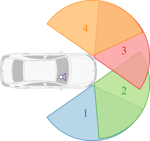
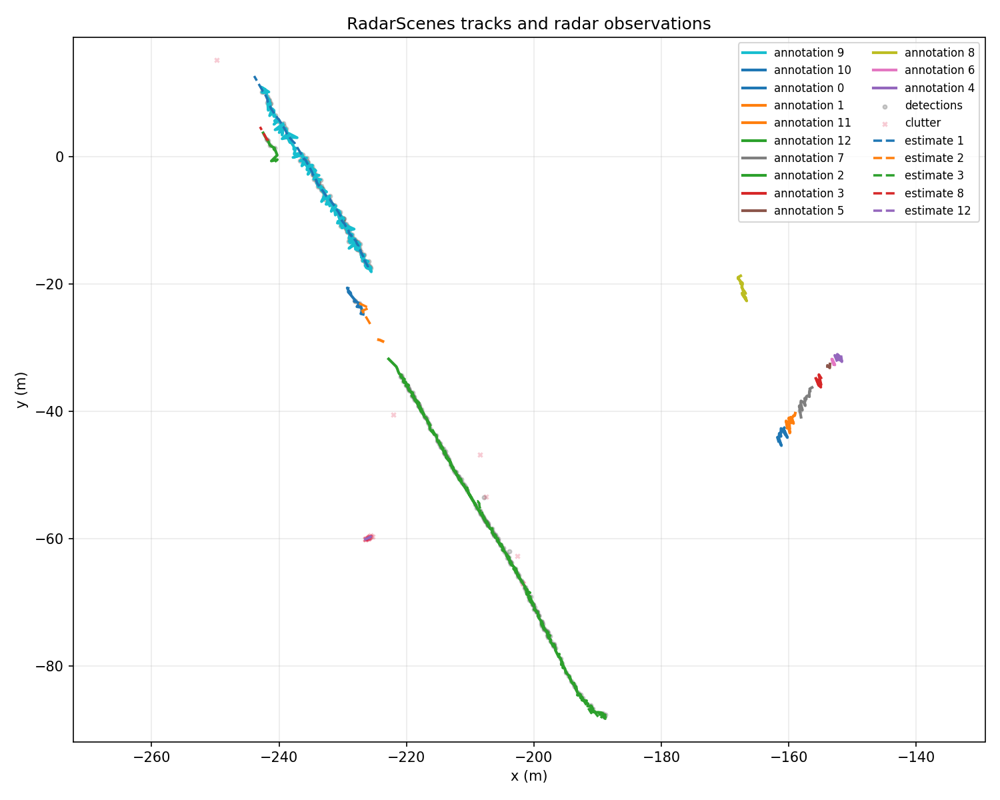

# Radar Tracker

A C++ multi-object radar tracker tested with real automotive radar data.



It includes:

- Kalman and extended Kalman filters
- Multiple-target tracking and clutter handling
- Two-sensor fusion
- CPU multithreading and portable OpenCL acceleration
- Python tools for downloading data, running tests, and plotting results

## Run it

Requirements: CMake, a C++17 compiler, and Python 3.10+.

```bash
python3 -m venv .venv
.venv/bin/pip install -r python/requirements.txt

cmake -S . -B build -DCMAKE_BUILD_TYPE=Release
cmake --build build --parallel
ctest --test-dir build --output-on-failure

.venv/bin/python -m python.download_radarscenes_sample
.venv/bin/python -m python.run_radarscenes real_data/radarscenes_sequence_158
```

Plots and metrics are written to `real_output/`.

Use `--accelerator opencl` for the portable backend. It uses a float32 kernel so
it can run on a wide range of GPUs, CPUs, and embedded accelerators. An optional
CUDA backend is also available for NVIDIA hardware.

## Results

The real-data test uses sequence 158 from the
[RadarScenes dataset](https://radar-scenes.com/):



*Real radar detections and annotated paths compared with the tracker estimates.*

- 5 real targets produced confirmed tracks
- 1 false confirmed track
- 0 identity switches
- 0.37 m position RMSE

On an Apple M2, the portable OpenCL kernel was 59.7x faster than serial CPU at
1,024 objects. Its one-shot end-to-end path was slower because buffer setup and
transfers dominated, which identifies the next optimization: persistent buffers.

See [the report](docs/REPORT.md), [real-data notes](docs/REAL_DATA.md), and
[portable acceleration notes](docs/PORTABLE_ACCELERATION.md) for details and
limitations. Full CUDA measurements are in the
[benchmark record](docs/BENCHMARK_RECORD.md) for backend comparison.

This is an educational project, not a safety-critical radar system.
